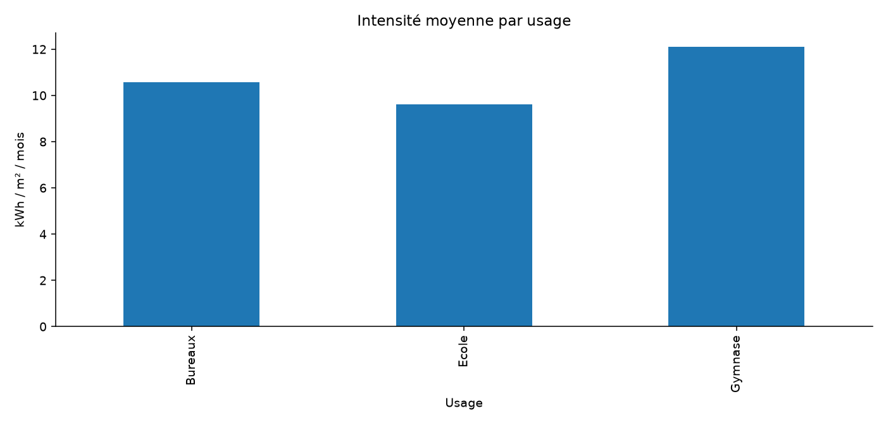

# ÉcoBâti — consommation énergétique du parc

Quels bâtiments et usages méritent un diagnostic énergétique après prise en compte de la surface et de la météo ?

## Mon approche

Je contrôle le grain et les exclusions, puis je calcule les indicateurs à partir des transactions valides. Je confronte les résultats aux hypothèses et propose des investigations concrètes. Les données sont synthétiques : elles ne représentent aucune mission réelle.

## Fichiers

- `notebooks/analyse.ipynb` : calculs reproductibles, graphiques et interprétations.
- `data/` : sources et données nettoyées au format CSV.
- `analysis/` : indicateurs et tableaux exportés.
- `presentation/soutenance.pptx` : rapport modifiable.
- `presentation/soutenance.pdf` : version de lecture du rapport.

## Reproduire

Installer Python 3.12 et les dépendances : `python -m pip install -r requirements.txt`. Ouvrir le notebook dans Jupyter ou VS Code, sélectionner le noyau Python et exécuter toutes les cellules dans l’ordre.

Les limites et hypothèses figurent dans le notebook et le rapport.

## Aperçu

## Quelques repères

Ces valeurs décrivent le jeu synthétique utilisé dans ce projet.

| Indicateur | Valeur |
|---|---:|
| observations | 4 310 |
| batiments | 120 |
| consommation totale kwh | 191 317 429,4000 |
| intensite mensuelle ponderee | 10,7580 |

## Tableau

Ouvrir le [classeur Tableau avec ses données](tableau/EcoBati.twbx). Les [consignes](tableau/OUVRIR.md) précisent les contrôles effectués et la validation d’ouverture restante dans Tableau.
